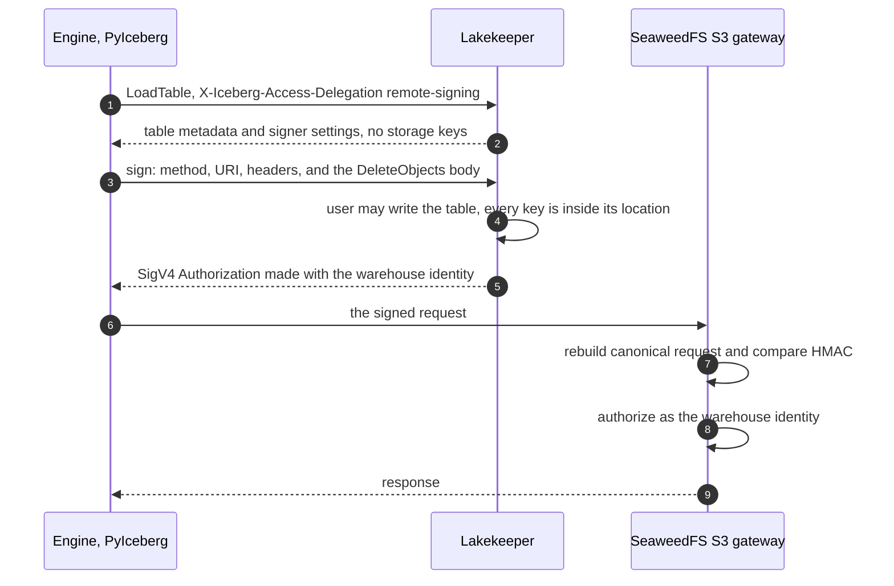
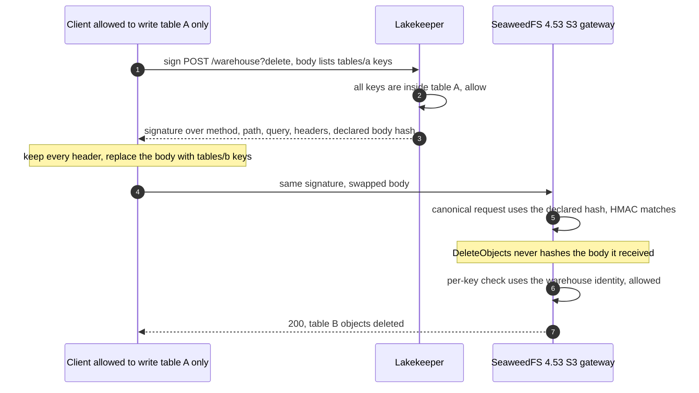
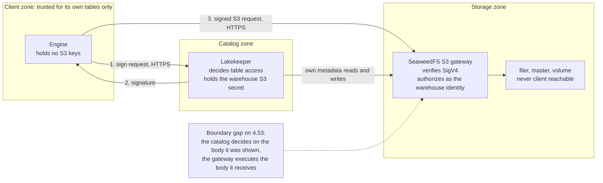

# Remote signing with this image

> [!CAUTION]
> **On SeaweedFS 4.53, remote signing does not keep a client inside its
> table.** It was measured, not assumed: a client holding a remote signature
> for a `DeleteObjects` request in its own table can replace the request body
> after signing and delete objects in **any other table** the signing identity
> can reach. SeaweedFS accepts the changed request and deletes the other
> table's objects. Use remote signing only where every client that can obtain
> a signature is already trusted with every table the signing identity covers.
> Where table isolation matters, the signature is not the control; see
> [what to use instead](#what-to-use-when-table-isolation-matters).

Remote signing is a **supported feature with documented limits** in this
project (owner decision, 2026-11-11; see [SUPPORT.md](SUPPORT.md)). It is **not
a table-isolation control on SeaweedFS**. This document explains how to use it,
exactly which parts of a signed request SeaweedFS checks, what the unchecked
part allows, and the evidence behind each statement.

## Contents

- [What remote signing is](#what-remote-signing-is)
- [How to use it with this image](#how-to-use-it-with-this-image)
- [Limits and risks](#limits-and-risks)
- [What SeaweedFS's signature check covers](#what-seaweedfss-signature-check-covers)
- [Diagrams](#diagrams)
- [Comparison with Lakekeeper's statement](#comparison-with-lakekeepers-statement)
- [Evidence and what it does not prove](#evidence-and-what-it-does-not-prove)
- [Draft upstream note](#draft-upstream-note-not-filed)

## What remote signing is

An Iceberg REST catalog can authorize data access in one of two ways. With
**credential vending**, the catalog gives the engine temporary storage keys
scoped to the table. With **remote signing**, the engine gets no storage keys
at all. Before every S3 request, the engine sends the request's method, URI,
headers, and (for `DeleteObjects`) body to the catalog's sign endpoint. The
catalog checks that the user may access the table and that the request stays
inside the table's location, signs it with the warehouse's own S3 credential
(AWS Signature Version 4, "SigV4"), and returns the signature. The engine then
sends the signed request to S3 itself, so data never passes through the catalog.

The security of that design rests on one assumption: **the object store checks
every part of the request the catalog approved.** The catalog approves a
request; the store sees only a signature. If the store leaves any part of the
request outside its signature check, the engine can change that part after the
catalog approved it, and the store will still accept it with the warehouse's
full authority.

## How to use it with this image

This how-to uses Lakekeeper as the catalog and the separated-role production
profile. Every key below is a placeholder; generate your own and never commit
them.

### 1. Give the signer its own S3 identity

The signer identity is the authority every remote-signed request carries, so
**its scope is the blast radius of the limit described below.** Scope it to the
warehouse bucket only, and give each trust domain its own bucket and its own
signer identity. Do not reuse an administrator identity.

Generate a key pair:

```console
python3 -c 'import secrets; print("lakekeeper" + secrets.token_hex(8)); print(secrets.token_urlsafe(32))'
```

Add an identity to the `s3.json` you supply to the S3 role with `-config`
(see [configuration](CONFIGURATION.md)):

```json
{
  "identities": [
    {
      "name": "lakekeeper-warehouse",
      "credentials": [
        {"accessKey": "<generated access key>", "secretKey": "<generated secret key>"}
      ],
      "actions": ["Read:warehouse", "Write:warehouse", "List:warehouse", "Tagging:warehouse"]
    }
  ]
}
```

Mount the file read-only, as `tests/s3.sh` does. Serve the S3 listener over TLS
with a certificate and key and **without** `-port.https`, as described in
[TLS](TLS.md#client-facing-tls-on-the-s3-listener). A signature captured in
transit can be replayed for up to 15 minutes (see
[limits](#limits-and-risks)), so plaintext S3 is not acceptable for remote
signing.

### 2. Configure the Lakekeeper storage profile

Create the warehouse with remote signing enabled, vended credentials disabled,
and path-style addressing (this image's S3 listener does not configure
virtual-host bucket domains):

```json
{
  "warehouse-name": "lakehouse",
  "storage-profile": {
    "type": "s3",
    "bucket": "warehouse",
    "key-prefix": "lakehouse",
    "region": "local",
    "endpoint": "https://seaweedfs-s3.example.internal:8333",
    "flavor": "s3-compat",
    "path-style-access": true,
    "sts-enabled": false,
    "remote-signing-enabled": true,
    "remote-signing-url-style": "path"
  },
  "storage-credential": {
    "type": "s3",
    "credential-type": "access-key",
    "aws-access-key-id": "<lakekeeper-warehouse access key>",
    "aws-secret-access-key": "<lakekeeper-warehouse secret key>"
  }
}
```

The field names are those of Lakekeeper's
[S3 storage profile](https://github.com/lakekeeper/lakekeeper/blob/main/docs/docs/storage-s3.md).
Lakekeeper must trust the CA that issued the S3 listener's certificate.

### 3. Configure the engine

**PyIceberg.** PyIceberg implements remote signing only in its fsspec file IO
(`S3V4RestSigner` in `pyiceberg/io/fsspec.py`), so select that IO and ask the
catalog for remote signing. The engine holds no S3 keys:

```python
from pyiceberg.catalog.rest import RestCatalog

catalog = RestCatalog(
    "lakehouse",
    **{
        "uri": "https://lakekeeper.example.internal/catalog",
        "warehouse": "lakehouse",
        "header.X-Iceberg-Access-Delegation": "remote-signing",
        "py-io-impl": "pyiceberg.io.fsspec.FsspecFileIO",
        # Authentication to Lakekeeper itself, for example OAuth2:
        "credential": "<client id>:<client secret>",
    },
)
```

Lakekeeper returns the S3 endpoint, region, path-style setting, and the
`s3.signer` settings in each table's configuration. PyIceberg's default
delegation header is `vended-credentials`, which is why it is set explicitly
here. The engine must also trust the S3 listener's CA.

**Trino 484 does not support remote signing.** Its Iceberg REST connector can
use vended credentials or its own static S3 keys. Static keys give the engine
the warehouse's authority directly and bypass the catalog's table permissions
entirely.

**Sail 0.7.3** was not assessed for remote signing.

### 4. Check the deployment

- The signer identity is scoped to the warehouse bucket and to nothing else.
- Only clients that are trusted with **every table in that bucket** can obtain
  signatures (see [limits](#limits-and-risks)).
- The S3 listener presents TLS and refuses plaintext; `tests/s3-tls.sh` shows
  how to check both.
- The master, volume, and filer listeners are not reachable from the client
  network (see [TLS](TLS.md)); otherwise no S3-level control matters.

## Limits and risks

### The measured gap: `DeleteObjects` bodies are not bound to the signature

`DeleteObjects` (`POST /<bucket>?delete`) carries the keys to delete in its XML
body. The signer sees that body: PyIceberg sends it to the sign endpoint
precisely so "the signing service \[can\] authorize the keys being deleted", and
Lakekeeper authorizes the keys it is shown. SigV4 binds a body to a signature
only through the `x-amz-content-sha256` header: the header's *value* is signed,
and the server must then hash the body it actually received and compare.

SeaweedFS 4.53 includes the declared value in its signature check but **never
hashes the `DeleteObjects` body it receives** (`DeleteMultipleObjectsHandler` reads it with
`io.ReadAll` and parses it directly). `tests/signature-coverage.sh` measured the
consequence with the same signature reused:

| Request as sent | Outcome on 4.53 |
| --- | --- |
| Signed `DeleteObjects` listing a table A key, unchanged | accepted; the table A key is deleted |
| The same signature, body replaced by a table B key | **accepted; the table B object is deleted** |
| As above, with a signed `Content-MD5` of the original body | **accepted; the table B object is deleted** |
| As above, with a signed `x-amz-checksum-crc32` of the original body | **accepted; the table B object is deleted** |

### What this allows in this deployment

The changed request carries the signer identity's authority, not the client's.
With the identity in [step 1](#1-give-the-signer-its-own-s3-identity), a client
that may write **one** table can delete objects in **every** table of the
warehouse bucket: other tables' data files, manifests, and metadata JSON. An
Iceberg table whose metadata file is deleted is unreadable. The catalog's audit
log records an approved delete in the client's own table.

The gap is bounded by the signer identity, not by the catalog:

- objects in buckets the signer identity cannot write are out of reach;
- a client that can obtain any `DeleteObjects` signature can use it, including
  for an empty or harmless key list;
- each signature remains usable for up to 15 minutes (below).

### Other properties to know

- **Replay.** SeaweedFS accepts a request whose `x-amz-date` is within 15 minutes
  of its clock (`auth_signature_v4.go:647–652`) and keeps no record of used
  signatures. The suite reuses each signature several times. AWS S3 behaves the
  same way; TLS is what stops a third party from capturing one.
- **`UNSIGNED-PAYLOAD`.** When the signer signs `UNSIGNED-PAYLOAD`, SigV4 leaves
  the body out by design, on every S3 implementation. The suite measures that
  the body of such a `PutObject` can be replaced; the change stays on the key the
  catalog approved and cannot reach another table.
- **`CompleteMultipartUpload`.** By source reading, its XML body is not hashed
  either (`s3api_object_handlers_multipart.go:166`). Its upload ID and key are in
  the signed query and path, and its parts belong to that upload, so a changed
  part list stays inside the approved upload. **Not measured.**
- **Unsigned ordinary headers.** Headers outside `SignedHeaders` that do not
  start with `x-amz-` (for example `Content-Type`, `Range`, `If-Match`) are not
  covered, as SigV4 allows. They cannot change the bucket, key, or operation.
- **Tags.** A client that may write a table can set tags on its files, so do not
  base access or lifecycle rules on object tags (Lakekeeper gives the same
  advice).

### What to use when table isolation matters

Credential vending issues the client its own short-lived credentials, restricted
by a session policy to the table's location. The store then evaluates every
request against the **client's** policy rather than the warehouse's, so a body
the store does not hash can only name keys the client may already touch.
SeaweedFS 4.53 implements STS `AssumeRole` with session policies. In this
repository, IAM/STS credential vending is **unsupported** until its own
adversarial qualification passes; see [SUPPORT.md](SUPPORT.md).

Until then, if table isolation matters, use a separate bucket and a separate
signer identity per trust domain, so the signer's authority is no wider than
what each client may do.

## What SeaweedFS's signature check covers

Read from the locked upstream source (`4.53`, commit `4ab66fb76`) and measured
on the real image. Paths are under `weed/s3api/`.

The canonical request SeaweedFS rebuilds and HMACs is
`method \n path \n query \n canonical headers \n signed header names \n
payload hash` (`getCanonicalRequest`, `auth_signature_v4.go:1197–1209`), built
by `verifyV4Signature` (`auth_signature_v4.go:258–421`).

| Component | Source of the value SeaweedFS signs | Changed after signing (measured) |
| --- | --- | --- |
| Method | `r.Method` | rejected, `403 SignatureDoesNotMatch` |
| Path | the escaped request path, and its once-decoded form (`:359–387`) | rejected, `403 SignatureDoesNotMatch` |
| Query: value changed, parameter added, parameter removed | every query parameter, sorted (`getCanonicalQueryString`, `:745–754`) | rejected, `403 SignatureDoesNotMatch` |
| Signed header: value changed (`x-amz-copy-source`), removed (`Range`), `Host`, `x-amz-date` | the headers named in `SignedHeaders` (`extractSignedHeaders`, `:993–1021`) | rejected, `403 SignatureDoesNotMatch` |
| Unsigned `x-amz-*` header added (`x-amz-copy-source`) | refused outright by `verifySignedHeadersCoverage` (`:962–990`) | rejected, `403 SignatureDoesNotMatch` |
| Declared payload hash (`x-amz-content-sha256`) | the header value, as the last canonical line (`:654–669`) | rejected, `403 SignatureDoesNotMatch` |
| Body of `PutObject` and `UploadPart` | hashed while streaming and compared with the declared value (`getRequestDataReader`, `s3api_put_object_helper.go:20–47`) | rejected, `400 XAmzContentSHA256Mismatch`; nothing stored |
| Body of `DeleteObjects` | **not hashed**: `DeleteMultipleObjectsHandler` reads it with `io.ReadAll` (`s3api_object_handlers_delete.go:434–449`) | **accepted; the other table's object is deleted** |
| Body under `UNSIGNED-PAYLOAD` | not covered, by SigV4 design | accepted; stays on the signed key |

The body check is the only one that is not part of the signature itself, and
it exists only in the helper that `PutObject` (`s3api_object_handlers_put.go:157`)
and `UploadPart` (`s3api_object_handlers_multipart.go:397`) call. Every other
handler that reads a body reads it unchecked.

## Diagrams

### Intended flow



### Risk flow: the unchecked body crosses the table boundary



### Trust boundaries



The catalog is the only component that knows table boundaries, and the gateway
is the only component that executes requests. Remote signing is safe only if
the gateway executes exactly what the catalog approved. For the `DeleteObjects`
body on 4.53 it does not.

## Comparison with Lakekeeper's statement

Lakekeeper's [storage documentation](https://github.com/lakekeeper/lakekeeper/blob/main/docs/docs/storage.md)
says that on SeaweedFS "a client can change a request after it was signed, for
example to copy data from another table into its own or to delete files outside
its table." Measured against SeaweedFS **4.53** in this image:

- **"Delete files outside its table": reproduced.** The `DeleteObjects` body swap
  above deletes another table's objects.
- **"Copy data from another table into its own": not reproduced through the
  signature.** The copy source travels in `x-amz-copy-source`. Changing a signed
  copy source, or adding an unsigned one to a signed `PUT`, is rejected with
  `403 SignatureDoesNotMatch`. This repository has not determined whether the
  example describes an earlier SeaweedFS release, a different request shape, or
  a signer that signs a copy source it did not check. It does not claim that no
  other copy path exists; it claims only the cases measured.

Lakekeeper's conclusion — use vended credentials on SeaweedFS when table
isolation matters — stands on the delete case alone.

## Evidence and what it does not prove

`tests/signature-coverage.sh` runs in native CI on AMD64 and ARM64 against the
separated-role production topology (master, volume, filer, and S3 in separate
restricted containers). It creates its own bucket and two identities per run:
`setup` for ground truth and `signer`, a stand-in for the warehouse identity
with read, write, list, and tagging on that bucket. Each case sends a request
signed by `signer` unchanged, then the same signature with exactly one component
changed, and checks the outcome and the stored objects.

- Each component that SeaweedFS verifies is an assertion of the secure outcome
  with its exact status and error code; any other outcome fails the suite.
- Each component it does not verify is an **exact-outcome canary**: it asserts
  the precise observed outcome, fails on anything else, and fails with a
  `NOTICE` if SeaweedFS starts rejecting the change, so this document cannot go
  stale silently.
- The suite prints a per-component summary table in the CI log.

It does **not** run Lakekeeper or PyIceberg; it plays the signer itself with the
same SigV4 algorithm (checked against AWS's published SigV4 example). It does
not establish behavior of any other SeaweedFS version, of presigned URLs, of
virtual-host addressing, or of a deployment behind a proxy that sets
`X-Forwarded-*` headers. The PyIceberg configuration above follows PyIceberg's
source and is not exercised in CI.

## Draft upstream note (not filed)

Recorded here as a draft only; it has not been filed upstream.

> **`DeleteObjects` body is not verified against `x-amz-content-sha256`
> (4.53, `4ab66fb76`).** `getRequestDataReader` wraps the body in a SHA-256
> verifier for `PutObject` and `UploadPart`, but `DeleteMultipleObjectsHandler`
> reads `r.Body` directly. A SigV4 request whose declared payload hash covers
> one key list is therefore accepted with a different key list. This matters
> wherever signatures are produced by a party other than the sender, such as
> Iceberg REST remote signing. Suggested fix: verify the declared hash (and a
> supplied `Content-MD5` or `x-amz-checksum-*`) for every handler that reads a
> request body, returning `XAmzContentSHA256Mismatch` on mismatch.

## Related documents

- [Security policy](../SECURITY.md) — deployment-critical behavior.
- [Threat model](THREAT-MODEL.md), entry TM-16.
- [Support contract](SUPPORT.md) — classification of remote signing and STS.
- [TLS](TLS.md) — the S3 listener and the component boundary.
- [Iceberg fixture](ICEBERG.md) — the development round trip with static keys.
