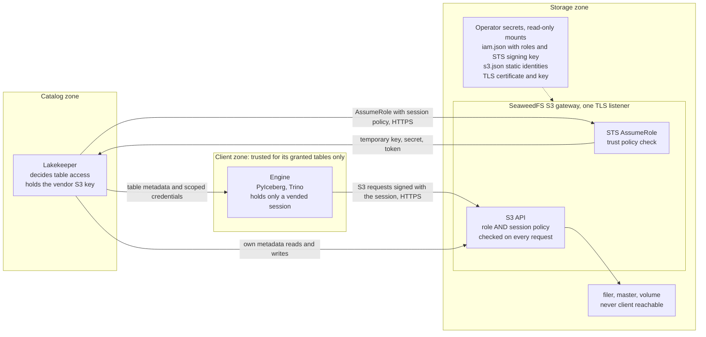
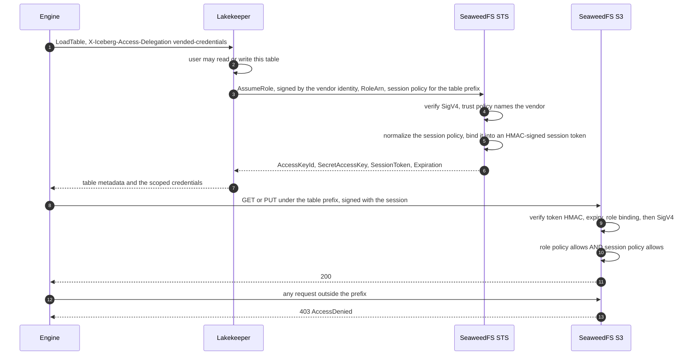
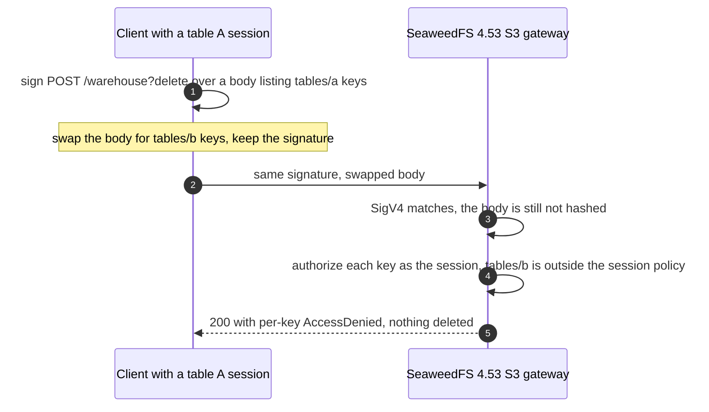

# STS credential vending

> [!IMPORTANT]
> IAM/STS credential vending is a **supported feature** of the separated-role
> production profile (owner decision, 2026-11-11), conditional on the
> adversarial qualification in `tests/sts.sh` passing on both native
> architectures. Its evidence and limits are below. Like every row in
> [SUPPORT.md](SUPPORT.md), the support attaches to an image only when a
> published release names an exact digest.

Credential vending is how an Iceberg REST catalog such as Lakekeeper keeps an
engine inside the tables it may use. The catalog does not lend the engine its
own authority, as [remote signing](REMOTE-SIGNING.md) does. It asks the object
store's Security Token Service (STS) for **new, short-lived credentials whose
authority is the intersection of a role and a session policy naming one table's
location**, and gives those to the engine. SeaweedFS then evaluates every
request the engine makes against that intersection.

## Contents

- [Why this is a table-isolation control](#why-this-is-a-table-isolation-control)
- [Diagrams](#diagrams)
- [Configure it](#configure-it)
- [Assumptions](#assumptions)
- [Limits](#limits)
- [Operations](#operations)
- [Evidence and what it does not prove](#evidence-and-what-it-does-not-prove)

## Why this is a table-isolation control

Three properties together make vended credentials safe where remote signing on
SeaweedFS is not. Each was read in the locked `4.53` source (commit
`4ab66fb76`) and measured on the real image.

1. **The authority travels with the credential, not with the request.** The
   session policy is embedded in the session token (claim `spol`) and the token
   is an HMAC-SHA256 JWT signed with the operator's STS signing key. A token
   whose policy is removed, or that is re-signed with another key or with
   `alg: none`, is refused. The temporary secret is
   `HMAC(signing key, session id)` (`weed/iam/sts/token_utils.go:214`), so it
   cannot be computed from the token.
2. **Every request is checked against the intersection.** For a session,
   `IsActionAllowed` requires the role's attached policies to allow the action
   **and** the session policy to allow it (`weed/iam/integration/iam_manager.go:1762–1799`).
   A session policy can only narrow a role; it can never widen it.
3. **Per-object checks include the objects a request names indirectly.** A copy
   source is authorized as a read of the source object (`AuthorizeCopySource`),
   and every key in a `DeleteObjects` body is authorized individually
   (`DeleteMultipleObjectsHandler` → `AuthorizeObjectDelete`).

### Why the remote-signing risk does not apply

The defect measured for remote signing is unchanged: SeaweedFS 4.53 still does
not bind a `DeleteObjects` body to the signature. What changes is **whose
authority the request carries**. Under remote signing, the swapped body is
executed with the warehouse identity's bucket-wide authority. Under vending, the
engine signs with its own scoped session, so a swapped body — or any body the
engine chooses to send — is authorized key by key against a policy that ends at
its table. `tests/sts.sh` replays the remote-signing attack with vended
credentials: the swapped request is accepted at the signature layer and deletes
nothing, with a per-key `AccessDenied`.

Remote signing must therefore be **disabled** (`remote-signing-enabled: false`)
on any warehouse where table isolation matters. Otherwise a client can ask for
remote signing instead of vended credentials and regain the warehouse's
authority.

## Diagrams

### Components and trust boundaries



### Vending sequence



### The remote-signing attack under vending



## Configure it

Every key below is a placeholder. Generate your own per deployment and never
commit them. The shape is the one `tests/sts.sh` generates and exercises.

### 1. Serve the S3 listener over TLS

STS shares the S3 listener, so STS is reachable over TLS exactly when the S3
listener is. Supply a certificate and key and omit `-port.https`
([TLS](TLS.md#client-facing-tls-on-the-s3-listener)). The image **refuses** to
start the `s3` role with `-iam.config` or an enabled `-iam` and no
`-cert.file`/`-key.file`. If a trusted proxy terminates TLS in front of the
gateway, set `SEAWEEDFS_UBI_ALLOW_PLAINTEXT_STS=true`; the proxy-to-gateway hop
is then your responsibility.

### 2. Give the catalog a static identity that is not an administrator

In the `s3.json` passed with `-config`:

```json
{
  "identities": [
    {
      "name": "lakekeeper",
      "credentials": [{"accessKey": "<generated>", "secretKey": "<generated>"}],
      "actions": ["Read:warehouse", "Write:warehouse", "List:warehouse", "Tagging:warehouse"]
    }
  ]
}
```

Lakekeeper uses this identity for its own metadata reads and writes and to call
`AssumeRole`. **Never use an `Admin` identity here**: SeaweedFS lets an
administrator assume a session for itself without a role, and that session
keeps administrator rights.

### 3. Define the role, its permissions, and the STS signing key

The advanced IAM file passed with `-iam.config` holds the role, its permission
policy, its trust policy, and the STS signing key. **It is secret material**:
mount it read-only from your secret store and restrict who can read it.

```json
{
  "sts": {
    "issuer": "seaweedfs-sts.example.internal",
    "signingKey": "<base64 of 32 random bytes: openssl rand -base64 32>",
    "tokenDuration": "1h",
    "maxSessionLength": "1h"
  },
  "policy": {"defaultEffect": "Deny", "storeType": "memory"},
  "policies": [
    {
      "name": "warehouse-tables",
      "document": {
        "Version": "2012-10-17",
        "Statement": [
          {
            "Effect": "Allow",
            "Action": ["s3:GetObject", "s3:GetObjectVersion", "s3:PutObject", "s3:DeleteObject",
                       "s3:AbortMultipartUpload", "s3:ListMultipartUploadParts"],
            "Resource": ["arn:aws:s3:::warehouse/lakehouse/*"]
          },
          {
            "Effect": "Allow",
            "Action": ["s3:ListBucket"],
            "Resource": ["arn:aws:s3:::warehouse"],
            "Condition": {"StringLike": {"s3:prefix": ["lakehouse/*"]}}
          },
          {
            "Effect": "Allow",
            "Action": ["s3:GetBucketLocation"],
            "Resource": ["arn:aws:s3:::warehouse"]
          }
        ]
      }
    }
  ],
  "roles": [
    {
      "roleName": "lakekeeper-vended",
      "roleArn": "arn:aws:iam::000000000000:role/lakekeeper-vended",
      "trustPolicy": {
        "Version": "2012-10-17",
        "Statement": [{
          "Effect": "Allow",
          "Principal": {"AWS": "arn:aws:iam::000000000000:user/lakekeeper"},
          "Action": ["sts:AssumeRole"]
        }]
      },
      "attachedPolicies": ["warehouse-tables"]
    }
  ]
}
```

- **The role is the ceiling.** Scope its permission policy to the warehouse's
  key prefix, not the whole bucket and never `s3:*`.
- **The trust policy names exactly the catalog's identity.** A static identity
  named `lakekeeper` has the principal `arn:aws:iam::000000000000:user/lakekeeper`
  in SeaweedFS 4.53; the account ID is fixed.
- **Always set `signingKey`.** Without it, SeaweedFS falls back to
  `jwt.filer_signing.key` or the SSE-S3 key, coupling unrelated secrets.
- `defaultEffect: Deny` makes anything no statement allows a denial.
- Roles defined in this file persist across restarts because they are reloaded
  from it; sessions persist because they are self-contained signed tokens.

### 4. Start the gateway

```console
podman run -d --name seaweedfs-s3 \
  --read-only --cap-drop=ALL --security-opt=no-new-privileges \
  -v seaweedfs-s3-secrets:/etc/seaweedfs:ro \
  -p 8333:8333 \
  ghcr.io/datopsis/seaweedfs-ubi:<tag> s3 -filer=filer:8888 \
    -config=/etc/seaweedfs/s3.json -iam.config=/etc/seaweedfs/iam.json \
    -cert.file=/etc/seaweedfs/tls.crt -key.file=/etc/seaweedfs/tls.key
```

With `-iam.config`, the image keeps upstream's IAM route on and pins its
management API read-only (`-iam.readOnly=true`). SeaweedFS 4.53 needs that route
for AWS-SDK-shaped STS calls: the fallback STS handler parses the form body
before verifying the signature, so with `-iam=false` every `AssumeRole` that
omits `x-amz-content-sha256` (as AWS SDKs, including Lakekeeper's, do) fails
with `AccessDenied`. This was observed in native CI before the image was
changed. The management API itself is not supported: writes are refused even
for administrators, and the catalog identity cannot read it. Without
`-iam.config`, the image injects `-iam=false` so upstream cannot start STS
implicitly.

### 5. Configure the Lakekeeper storage profile

```json
{
  "warehouse-name": "lakehouse",
  "storage-profile": {
    "type": "s3",
    "bucket": "warehouse",
    "key-prefix": "lakehouse",
    "region": "local",
    "endpoint": "https://seaweedfs-s3.example.internal:8333",
    "path-style-access": true,
    "flavor": "s3-compat",
    "sts-enabled": true,
    "sts-role-arn": "arn:aws:iam::000000000000:role/lakekeeper-vended",
    "sts-endpoint": "https://seaweedfs-s3.example.internal:8333",
    "sts-token-validity-seconds": 900,
    "remote-signing-enabled": false
  },
  "storage-credential": {
    "type": "s3",
    "credential-type": "access-key",
    "aws-access-key-id": "<lakekeeper access key>",
    "aws-secret-access-key": "<lakekeeper secret key>"
  }
}
```

- `remote-signing-enabled: false` is **required** where table isolation matters
  (see [above](#why-the-remote-signing-risk-does-not-apply)).
- `sts-session-policy-principal` stays unset (`false`): SeaweedFS does not need
  a `Principal` in session policies, and the tests use Lakekeeper's default shape
  without one.
- `sts-token-validity-seconds` must be at least 900, SeaweedFS's minimum
  `DurationSeconds`, and at most `maxSessionLength`.
- Lakekeeper must trust the CA that issued the gateway certificate.

### 6. Configure the engines

- **PyIceberg** requests vended credentials by default
  (`X-Iceberg-Access-Delegation: vended-credentials`) and needs no S3 keys of
  its own. It must trust the gateway's CA.
- **Trino 484** uses vended credentials with
  `iceberg.rest-catalog.vended-credentials-enabled=true`; it does not support
  remote signing. Not exercised here.
- **Sail 0.7.3** was not assessed.

Do not also give engines static S3 keys: a static key carries its own authority
and bypasses the catalog entirely.

## Assumptions

Vending is safe only while these hold. Each belongs to the deployment.

| Assumption | Why it matters | Owner |
| --- | --- | --- |
| The S3 listener serves TLS and clients verify it | Temporary secrets and session tokens cross the network | Deployment; the image refuses STS without TLS |
| `iam.json` and `s3.json` are secret, read-only mounts | `iam.json` holds the STS signing key: anyone with it can mint any session | Deployment and secret store |
| Clocks are synchronized (NTP) | Session expiry and the 15-minute SigV4 window use the gateway's clock | Host |
| The catalog identity is not an administrator | An administrator can self-assume an administrator session | Storage operator |
| The role's permission policy is reviewed | It is the ceiling every session inherits | Storage operator |
| Engines hold no static S3 keys | A static key bypasses the catalog | Deployment |
| Remote signing is disabled on isolated warehouses | It lends the catalog's authority | Catalog operator |
| Filer, master, and volume listeners are unreachable from clients | Direct reads bypass S3 authorization entirely ([TLS](TLS.md)) | Network |
| Every S3 gateway shares one `iam.json` | Sessions are validated by whichever gateway receives them | Storage operator |

## Limits

- **No revocation API.** SeaweedFS 4.53 contains a session revocation list, but
  nothing exposes it. A session stays valid until it expires, unless you rotate
  the signing key (ends every session) or change the role's trust policy or
  name and restart (ends that role's sessions, because a session is bound to its
  role's ID, a hash of the name and trust policy). Keep sessions short.
- **The token is readable.** It is signed, not encrypted: anyone holding it can
  read the role, session name, and session policy. Do not put secrets in session
  names. The token alone does not authenticate a request; the secret is needed
  too.
- **Session policies are limited to 2048 characters** after normalization.
- **Only `AssumeRole` is qualified.** `AssumeRoleWithWebIdentity`,
  `AssumeRoleWithLDAPIdentity`, `GetFederationToken`, the embedded IAM
  management API, and filer-stored roles are not.
- **Static identities still work.** Vending adds a path; it does not remove the
  static identities in `s3.json`.
- **One host.** The tests run the separated roles on one host. Multiple gateways
  behind a load balancer are expected to work with a shared `iam.json`, but were
  not tested.

## Operations

### Durations

`DurationSeconds` must be between 900 and `maxSessionLength` (at most 43200).
Lakekeeper sends `sts-token-validity-seconds`. A role may also set
`maxSessionDuration` (3600–43200), which caps the sessions it issues.

### Rotating the STS signing key

1. Generate a new key: `openssl rand -base64 32`.
2. Replace `signingKey` in `iam.json` in the secret store.
3. Restart every S3 gateway. Every existing session is refused from that moment
   with `InvalidAccessKeyId`; Lakekeeper vends new sessions on the next table
   load.

There is no overlap window: SeaweedFS accepts one signing key. Schedule rotation
when a brief failure of in-flight engine queries is acceptable.

### Revoking

- **Everything:** rotate the signing key.
- **One role's sessions:** change its trust policy (or rename it) and restart the
  gateways; sessions bound to the old role ID are refused.
- **The catalog's ability to vend:** remove the catalog from the trust policy, or
  disable its static identity in `s3.json`.

### Logs

The gateway does not log the signing key, static secrets, session secrets, or
session tokens in the tested configuration (asserted by `tests/sts.sh`). Keep
log verbosity at the default; see [logging](LOGGING.md).

## Evidence and what it does not prove

`tests/sts.sh` runs in native CI on AMD64 and ARM64 with the separated-role
production topology. It generates a private CA, identities, an STS signing key,
and buckets for the run. The STS-enabled gateway runs with a read-only root,
all capabilities dropped, and `no-new-privileges`. Every assertion is exact:

| Area | Assertions |
| --- | --- |
| TLS | The gateway listens only on 8333 (TLS) and 18333 (gRPC); a plaintext AssumeRole receives the TLS listener's `400` and no credentials. The default profile, given a signing key through `security.toml`, serves no STS. |
| Table scope | A Lakekeeper-shaped table A session can PUT, GET, LIST, copy within, multipart-upload into, and DELETE in table A; GET, PUT, DELETE, LIST (prefix and whole bucket), CopyObject from B into A, multipart initiate into B, UploadPart into a B upload, a sibling prefix sharing A's name, and another bucket are each `403 AccessDenied`, and ground truth shows nothing changed. |
| Read-only | A read-only session can GET; PUT and DELETE are `403 AccessDenied`. |
| Intersection | A session policy of `s3:*` on every bucket reaches only what the role allows; outside the role's prefix, another bucket, and bucket creation are `403 AccessDenied`. A session without a policy reads table B, so the table A denials come from the session policy. |
| Trust | An identity outside the trust policy, an unsigned request, self-assumption without a RoleArn, a missing role, GetFederationToken, and a vended session re-assuming the role are each `403 AccessDenied`, and each refusal's message is checked so that a refusal for an unrelated reason (such as a signature failure) cannot pass. |
| Forgery | A token with its session policy removed, the same claims signed with another key, `alg: none`, the right token with a wrong secret, a secret derived without the signing key, another session's key with this token, and temporary keys without a token are each refused with the exact error. |
| Expiry | A 900-second session's `Expiration` is 900 s after issue; it works 60 s before and is refused 15 s after with `403 InvalidAccessKeyId`. |
| Persistence and rotation | A session survives a gateway restart with the same key and is refused after a restart with a new key, while a new session works. |
| Unverified component | PR 1's swapped `DeleteObjects` body, signed by a table A session, deletes nothing: `200` with a single per-key `AccessDenied` for the table B key. |
| IAM route | With `-iam.config` the gateway runs with `-iam.readOnly=true`; an administrator's `CreateUser` is `403 AccessDenied` ("IAM write operations are disabled") and the catalog identity's `ListUsers` is `403 AccessDenied`. |
| Secrets | No signing key, static secret, session secret, or session token appears in the gateway log. |

## Draft upstream note (not filed)

> **Fallback STS route parses the body before SigV4 verification (4.53,
> `4ab66fb76`).** `HandleSTSRequest` calls `r.ParseForm()` before
> `handleAssumeRole` calls `verifyV4Signature`. For a request without
> `x-amz-content-sha256`, the verifier then hashes an already-consumed body,
> so AWS-SDK `AssumeRole` calls fail with `AccessDenied` whenever the request
> reaches the fallback route (`-iam=false`). `UnifiedPostHandler` avoids this by
> verifying first and restoring the body. Suggested fix: verify (or buffer the
> body) before `ParseForm` in `HandleSTSRequest`.

Not established: Lakekeeper, PyIceberg, or Trino actually exercising this path
(the suite plays the catalog with Lakekeeper's exact session-policy shape);
multiple gateways; multi-host deployment; other STS actions; behavior of any
other SeaweedFS version.
